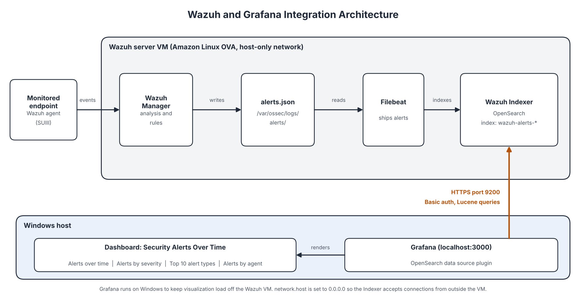

# Wazuh Grafana SOC Dashboard

A Grafana dashboard for Wazuh security monitoring. Grafana runs on a Windows host and reads alert data directly from the Wazuh Indexer (OpenSearch) over HTTPS on port 9200. The dashboard shows alert trends, severity levels, the most common alert types, and alert volume per agent. Its numbers were checked against the raw Wazuh alert log.

Built as Task 5 of a SOC Analyst internship at ITSOLERA.

## Contents

- [Overview](#overview)
- [Architecture](#architecture)
- [Why port 9200](#why-port-9200)
- [Requirements](#requirements)
- [Setup](#setup)
- [Dashboard panels](#dashboard-panels)
- [Validation](#validation)
- [Challenges and fixes](#challenges-and-fixes)
- [Notes and limitations](#notes-and-limitations)
- [Repository structure](#repository-structure)

## Overview

Wazuh already stores every alert it generates in the Wazuh Indexer. Grafana does not need a separate pipeline to use that data. The OpenSearch data source plugin queries the `wazuh-alerts-*` index directly, so the dashboard always reflects what Wazuh has indexed.

Grafana is installed on Windows instead of on the Wazuh VM. This keeps the visualization load and disk use away from the VM that runs the manager and the Indexer.

## Architecture



1. The Wazuh agent on the monitored endpoint sends events to the Wazuh Manager.
2. The Manager analyzes the events with its rules and writes alerts to `/var/ossec/logs/alerts/alerts.json`.
3. Filebeat reads that file and ships the alerts to the Wazuh Indexer, which stores them in `wazuh-alerts-*`.
4. Grafana on the Windows host queries the Indexer over HTTPS on port 9200 and renders the dashboard.

## Why port 9200

Port 9200 is the default HTTPS port of the Wazuh Indexer (OpenSearch) REST API. Every query Grafana sends, such as index lookups, term aggregations, and date histograms, is an HTTPS request to this port. It is the same endpoint Wazuh uses internally, so no extra service or custom port was needed.

By default the Indexer listens on `127.0.0.1` only, so it refuses connections from other machines. For this setup `network.host` was set to `0.0.0.0` so Grafana on the Windows host can reach it. See [`config/opensearch.yml.snippet`](config/opensearch.yml.snippet).

## Requirements

- A running Wazuh server (manager and indexer) with at least one enrolled agent
- Network access from the Grafana host to the Wazuh VM on port 9200 (host-only or bridged adapter)
- Grafana on Windows (tested with v13.1.3)
- The `grafana-opensearch-datasource` plugin
- Indexer credentials with permission to read `wazuh-alerts-*`

## Setup

### 1. Let the Indexer accept outside connections

On the Wazuh VM, set this line in `/etc/wazuh-indexer/opensearch.yml`:

```yaml
network.host: "0.0.0.0"
```

Restart the service and check the binding:

```bash
sudo systemctl restart wazuh-indexer
sudo ss -tlnp | grep 9200
```

The output should show `*:9200` or `0.0.0.0:9200`, not `127.0.0.1:9200`.

### 2. Check the connection from Windows

In PowerShell, use `curl.exe`. Plain `curl` is an alias for `Invoke-WebRequest` and does not accept the same flags.

```powershell
curl.exe -k -u <INDEXER_USER>:<INDEXER_PASSWORD> https://<WAZUH_VM_IP>:9200
```

A JSON response with the cluster name means the Indexer is reachable.

### 3. Install Grafana and the plugin

Install Grafana with the Windows installer from grafana.com. Then, from an administrator PowerShell in the Grafana `bin` folder:

```powershell
.\grafana-cli.exe plugins install grafana-opensearch-datasource
net stop grafana
net start grafana
```

Open `http://localhost:3000`.

### 4. Add the data source

Go to **Connections > Data sources > Add data source > OpenSearch** and use the values in [`config/datasource-settings.md`](config/datasource-settings.md). The main ones are:

| Setting | Value |
|---|---|
| URL | `https://<WAZUH_VM_IP>:9200` |
| Auth | Basic auth with your Indexer credentials |
| Skip TLS Verify | On (self-signed certificate) |
| Index name | `wazuh-alerts-*` |
| Time field | `@timestamp` |

Click **Save & test**.

### 5. Import the dashboard

Go to **Dashboards > New > Import** and upload [`dashboards/security-alerts-dashboard.json`](dashboards/security-alerts-dashboard.json). The file was exported from Grafana v13.1.3 in the newer dashboard schema, so use a recent Grafana version. If a panel shows a data source error after import, open the panel and select your OpenSearch data source.

## Dashboard panels

All panels use the Lucene query type on `wazuh-alerts-*` with a Count metric.

| Panel | Group by | Visualization | What it shows |
|---|---|---|---|
| Security Alerts Over Time | Date Histogram on `@timestamp` | Time series | Alert volume across the selected time range, including bursts |
| Alerts by Severity Level | Terms on `rule.level` (size 20) | Bar chart | How many alerts fall at each Wazuh severity level |
| Top 10 Alert Types | Terms on `rule.description` (size 10) | Horizontal bar chart | The most frequently triggered rules |
| Alerts by Agent | Terms on `agent.name` (size 20) | Pie chart | Share of alerts per reporting agent |

The severity panel uses a **Convert field type** transformation that turns `rule.level` into a string. The bar chart needs a string or time field on its category axis, and `rule.level` is numeric.

### Screenshots

| | |
|---|---|
|  |  |
|  |  |
|  |  |

## Validation

Two panels were compared with the raw alert log on the Wazuh server. The commands are in [`docs/validation-commands.md`](docs/validation-commands.md).

| Check | Grafana | Raw `alerts.json` | Result |
|---|---|---|---|
| Alerts with `rule.level` 3 | 479 | 479 | Match |
| Agent split | 90% SUIII, 10% wazuh-server | 920 and 113 alerts (about 89% and 11%) | Match after rounding |

On the first comparison Grafana showed 471 for level 3 while the log showed 479. The gap closed once the Indexer had caught up with the log, which points to indexing lag rather than a wrong query.


## Challenges and fixes

| Problem | Cause | Fix |
|---|---|---|
| `curl -k` failed in PowerShell | `curl` is an alias for `Invoke-WebRequest` | Use `curl.exe` |
| Connection to port 9200 failed, but ping worked | The Indexer listened on `127.0.0.1` only | Set `network.host: "0.0.0.0"` and restart `wazuh-indexer` |
| Indexer returned `Unauthorized` | The SSH login is not the Indexer login | Use the Indexer credentials |
| Panel error "invalid query, missing metrics and aggregations" | The Group By type defaulted to Geo Hash Grid | Change Group By to Terms and select the field |
| Bar chart said it needs a string or time field | `rule.level` is numeric | Add a Convert field type transformation to string |
| Bar gauge showed only one bucket | Wrong visualization for a grouped breakdown | Use a bar chart instead |

## Notes and limitations

- **Lab setup.** The Wazuh OVA was installed fresh for this task, so earlier agent connections were lost. Only two agents reported during testing: `SUIII` and `wazuh-server`. The agent panel reflects event volume per agent, not live connection status. For connection status, use the Wazuh API `/agents` endpoint.
- **Credentials.** The lab used the default Indexer credentials. Change them in any real deployment and never commit them to a repository.
- **TLS.** Skip TLS Verify is on because the certificate is self-signed. For production, add the Wazuh root CA to Grafana instead.
- **Network exposure.** `network.host: "0.0.0.0"` is acceptable on an isolated host-only network. Otherwise bind to a specific interface and restrict port 9200 with a firewall.
- **Alert worth reviewing.** The Top 10 panel includes "Powershell process created an executable file in Windows root folder", which deserves manual review rather than being treated as noise.

## Repository structure

```
wazuh-grafana-soc-dashboard/
├── README.md
├── architecture/
│   └── architecture.png
├── config/
│   ├── opensearch.yml.snippet
│   └── datasource-settings.md
├── dashboards/
│   └── security-alerts-dashboard.json
├── docs/
│   └── validation-commands.md
└── screenshots/
```

## Author

Usman Javaid
